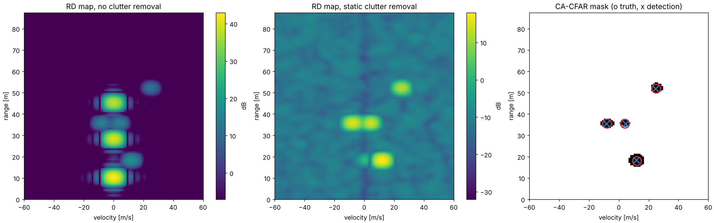
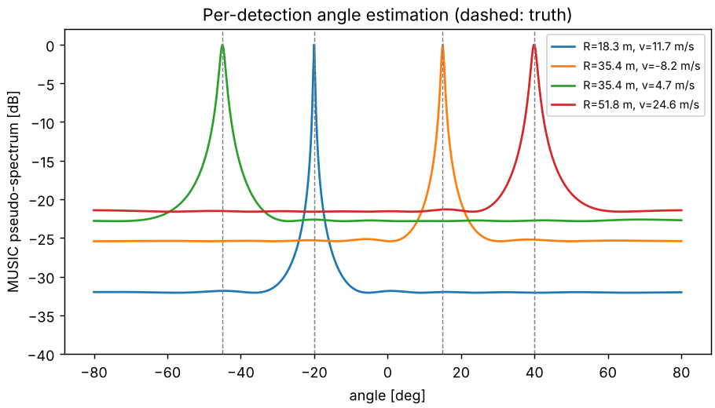
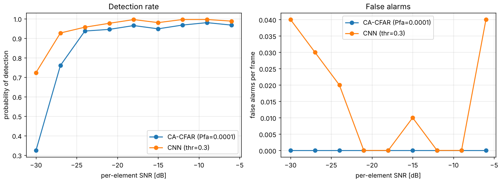

# OFDM ISAC Radar

A compact, end-to-end Python implementation of **monostatic OFDM radar sensing** for integrated
sensing and communications (ISAC), from the received resource grid to target detections,
plus a **PyTorch detector** trained on simulated range-Doppler maps and benchmarked against CA-CFAR.

The waveform uses a 5G NR FR2-like numerology (28 GHz, 120 kHz SCS), so the sensing signal is an
ordinary communication frame carrying random QPSK data.

## Processing chain

| Step | Function | What it does |
|---|---|---|
| 1. Radar cube | `processing.radar_cube` | Element-wise division `Y / X` removes the data symbols (reciprocal filter); matched-filter option for QAM |
| 2. Clutter suppression | `static_clutter_removal`, `mti_filter` | Removes zero-Doppler returns (slow-time mean subtraction or N-pulse canceller) |
| 3. Range | `range_doppler` | Windowed IFFT across subcarriers |
| 4. Doppler | `range_doppler` | Windowed FFT across OFDM symbols |
| 5. Detection | `ca_cfar_2d`, `cluster_peaks` | 2D cell-averaging CFAR (Doppler wrap-around) + local-max clustering |
| 6. Angle | `angle_fft`, `angle_music` | FFT beamforming or MUSIC across an 8-element ULA, per detection |

The echo model (`simulate.py`) is the standard frequency-domain OFDM radar model, valid while echo
delays stay within the cyclic prefix:

$$Y[n,m,k] = X[n,m]\sum_t a_t\, e^{-j2\pi n\Delta f\tau_t}\, e^{j2\pi f_{D,t} m T_s}\, e^{j2\pi k d\sin\theta_t/\lambda} + W[n,m,k]$$

## Quick start

```bash
pip install -r requirements.txt
python demo_pipeline.py      # classical chain on a 4-target scene with strong static clutter
python train_detector.py     # train the CNN detector and compare it with CA-CFAR
```

## Results

### Classical chain (`demo_pipeline.py`)

Scene: 4 moving targets (two share the same range bin) and 3 static clutter returns 20–25 dB
stronger than the targets, at −15 dB per-element SNR.

```
Ground truth:                              Detections (static clutter removal + MUSIC):
  R= 18.00 m  v= 12.00 m/s  θ= -20.0°        R= 18.30 m  v= 11.73 m/s  θ= -20.0°
  R= 35.50 m  v= -8.00 m/s  θ=  15.0°        R= 35.38 m  v= -8.21 m/s  θ=  15.0°
  R= 52.00 m  v= 25.00 m/s  θ=  40.0°        R= 35.38 m  v=  4.69 m/s  θ= -45.0°
  R= 35.50 m  v=  4.00 m/s  θ= -45.0°        R= 51.84 m  v= 24.63 m/s  θ=  40.0°
```

Without clutter removal, CFAR only finds the three static clutter peaks and misses every target.




### Learned detector (`train_detector.py`)

`RDDetector` is a small dilated fully-convolutional network (circular padding along Doppler) that
predicts a target-center heatmap on the RD map, trained with a CenterNet-style focal loss on randomly
generated scenes (1–4 targets, 0–3 clutter returns, −25 to −5 dB SNR).

Test set: 100 random frames per SNR point (2000 training frames, 10 epochs, ~3 min on a 2-core CPU).
A detection counts as a hit within ±2 range cells and ±1 Doppler cell of the true target.

| SNR [dB] | CA-CFAR Pd | CA-CFAR FA/frame | CNN Pd | CNN FA/frame |
|---:|---:|---:|---:|---:|
| −30 | 0.32 | 0.00 | **0.72** | 0.04 |
| −27 | 0.76 | 0.00 | **0.93** | 0.03 |
| −24 | 0.94 | 0.00 | 0.96 | 0.02 |
| −18 | 0.97 | 0.00 | 1.00 | 0.00 |
| −12 | 0.97 | 0.00 | 1.00 | 0.00 |
| −6  | 0.97 | 0.00 | 0.99 | 0.04 |

The CNN gains most at low SNR and also resolves targets that sit close together in the RD map,
where CFAR plus local-max clustering merges them (CFAR's plateau below 1.0 at high SNR). The two
detectors are not at an identical false-alarm rate here (CFAR at Pfa = 1e-4 produced no false
alarms on this test set, the CNN a few per hundred frames), so a fair next step is a full ROC sweep
over the CFAR Pfa and the CNN threshold.



## Repository layout

```
ofdm_radar/
  config.py        system parameters, derived resolutions, axes
  simulate.py      frequency-domain echo model (targets + static clutter + AWGN)
  processing.py    radar cube, clutter removal, range/Doppler, CA-CFAR, FFT/MUSIC angle
  ml_detector.py   dataset generation, RDDetector, focal loss, training/inference
demo_pipeline.py   classical chain demo + figures
train_detector.py  CNN training and CFAR benchmark
```

## Possible extensions

- Generate the OFDM signal and channel with [NVIDIA Sionna](https://github.com/NVlabs/sionna) (ray-traced scenes) instead of the point-target model
- Bistatic / multistatic sensing, 3GPP TR 38.901 ISAC channel model (Rel-19)
- GPU acceleration of the chain with CuPy, real over-the-air captures from an SDR testbed
- Joint sensing-communication objectives (e.g., sensing-aware resource allocation)

## Author

Namhyun Kim — PhD student, ECEE, Arizona State University ([website](https://namhyunk.github.io/))
